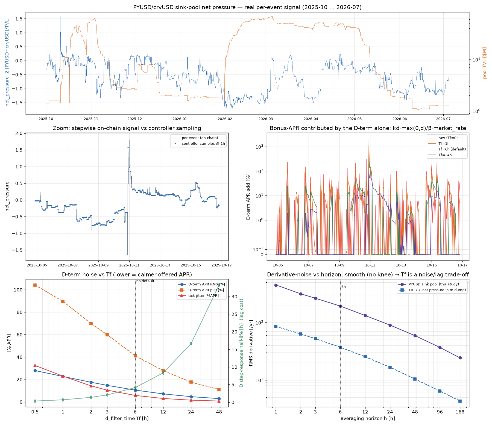
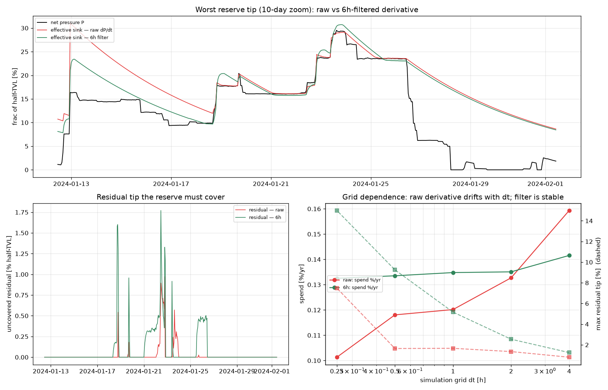

# Is `d_filter_time = 6h` right for the net-pressure PID derivative?

`contracts/net_pressure/PID.vy` low-passes the derivative of `pressure` with a
first-order Åström filter (discrete, `dt` & `Tf` in **years**, exactly as deployed):

```
d[k] = (Tf·d[k-1] + (P[k] − P[k-1])) / (Tf + dt)      # Tf = d_filter_time
target += kd · max(0, d[k])                            # only the RISING part is used
```

Real deposits / withdrawals / swaps land as **discrete steps**, so the raw derivative
(`Tf = 0`) is a spike train. This study drives the *exact* filter with the **real,
per-event, on-chain** net pressure and asks whether 6h is the right smoothing.

## Data — real per-block net pressure of the crvUSD sink pool

Net pressure is read from the pool we already track, the **PYUSD/crvUSD stableswap sink**
`0x625E92624Bc2D88619ACCc1788365A69767f6200` (coin0 PYUSD, coin1 crvUSD). When the system
runs a positive crvUSD net pressure, crvUSD is pulled out of the sink, so it skews
PYUSD-heavy:

```
net_pressure = 2·(b0_usd − b1_usd)/(b0_usd + b1_usd)     (+ = crvUSD scarce; per half-TVL)
```

`fetch_pool_netpressure.py` reconstructs balances at **per-event (≈ per-block) resolution**
without a chain read per block: it cumulative-sums the deltas from every
`TokenExchange / AddLiquidity / RemoveLiquidity[One|Imbalance]` event (`eth_getLogs`,
paginated at the node's 10k-block cap), and every ~3h **re-anchors** to on-chain
`balances()` / `totalSupply()` (one Multicall3) — which also supplies the timestamps
(interpolated between anchors) and an integrity check.

- **23,708 events** over 2025-10-01 … 2026-07-04 (277 d); TVL $1.07M → $68M → $5M.
- Reconciliation: `totalSupply` drift **exactly 0** (no missed events); reconstructed
  balances vs on-chain drift median $0.28, max ~$700 on $1M+ (admin-fee leakage,
  re-anchored away every 3h). The series is faithful.

Reproduce: `uv run python fetch_pool_netpressure.py` → `pool_netpressure.csv.xz`, then
`uv run python sim_pid_dfilter.py --save pics/pid_dfilter.png`.



## What the real signal looks like

- `net_pressure` swings in [−1.74, +1.58], std **0.49** — the sink runs persistently
  crvUSD-heavy but reverses hard during flows. (The derivative only sees Δ, so the offset
  is irrelevant.)
- Single events move it by up to **1.03**; the worst single **hour** by **1.95** — nearly
  the whole range in one controller step. These are exactly the stepwise-deposit spikes.
- **The derivative has no natural cutoff.** RMS(dP/dt) falls *smoothly* with the averaging
  horizon (448 → 193 → 90 → 24 /yr at 1h / 6h / 24h / 1week) — a near-random-walk. So there
  is **no "correct" Tf** to recover; Tf is a pure **noise-vs-lag trade-off**.

## D-term across `d_filter_time` (1h controller cadence)

`d_apr` = extra offered APR from the D-term alone = `kd·max(0,d)/sink_per_offer·market_rate`.

| Tf | dP/dt RMS [/yr] | d_apr RMS | d_apr p99 | d_apr max | tick jitter | corr w/ trend | half-life |
|----|-----|-----|-----|-----|-----|-----|-----|
| **0 (raw)** | 448 | 39.5% | 138% | **2116%** | 52.2% | 0.17 | 0 |
| 1h | 263 | 22.7% | 90% | 1061% | 22.9% | 0.29 | 0.7h |
| 3h | 174 | 14.8% | 60% | 529% | 10.5% | 0.44 | 2.1h |
| **6h (default)** | 126 | 10.5% | 41% | 302% | 5.8% | **0.57** | 4.2h |
| 12h | 88 | 7.2% | 28% | 166% | 3.0% | 0.73 | 8.3h |
| 24h | 59 | 4.7% | 18% | 89% | 1.6% | 0.88 | 16.6h |
| 48h | 38 | 3.0% | 11% | 45% | 0.8% | 0.98 | 33h |

*(These are on the **sink pool**, which is a **5.4× conservative stress case**: the actual
YB BTC net pressure — real-price sim dump — has std 0.09 vs 0.49 and hourly derivative RMS
85 vs 448 /yr. On the real YB signal every D-term figure above is ~5.4× smaller, e.g. at
6h: d_apr RMS ~1.9%, p99 ~7.6%.)*

## Verdict — 6h is well-chosen; keep it (6–12h all fine)

1. **Filtering is essential and the design is right.** Raw (`Tf=0`) peaks at 17,000/yr;
   one big flow would swing the offer by thousands of % and saturate `sink_cap`. Any
   nonzero Tf of a few hours removes that.
2. **6h sits in the sweet spot.** Noise (RMS/p99/jitter) has come down ~3.5× from raw while
   the step-response half-life is only ~4h — negligible against the downstream liquidity
   response of **6–11 days** (`REPORT_liquidity_response.md`). On the real YB-scale signal
   the D-term at 6h contributes ~2% RMS APR and never saturates.
3. **Don't go below ~3h:** jitter and spike heights escalate steeply toward the raw train.
4. **12h is a defensible, slightly-calmer alternative** (jitter halves, derivative becomes
   0.73-correlated with the genuine multi-day trend vs 0.57 at 6h; half-life still <9h ≪
   the multi-day pool response). Worth it only if sink-pool-scale noise is a worry.
5. **Above ~24–48h** the D-term gets too sluggish to "add urgency," defeating its purpose.
6. **The worst-case single huge flow saturates the D-term for any Tf ≲ 12h** — but that is
   bounded by `sink_cap` and decays over ~Tf. If that transient over-incentive matters, the
   right lever is `kd` / `sink_cap`, **not** a larger Tf.

**Bottom line: leave `d_filter_time = 6h`.** It is not knife-edge — anywhere in ~6–12h is
sound; 6h is the better default because it keeps the derivative's anticipatory value while
already removing essentially all of the stepwise spike energy that matters at YB scale.

## Does the 6h filter change the reserve sizing? (`sim_reserve_dfilter.py`)

The reserve sizer (`incentive_reserve_fine.py`) drives the leakage PID on the worst BTC
crash candidate with the **raw** `dP/dt` derivative and takes the residual tip
`d = max(0, P − S_eff)`. Rerunning it with the deployed **6h Åström** derivative, at the
real **1h** controller cadence (`min_interval`):

| model (1h grid) | gains | coverage | spend %/yr | worst tip | reserve to cover |
|---|---|---|---|---|---|
| raw dP/dt (idealised) | α1.19 Kp50 Ki1980 **Kd0.0153** Imax4.08 | 99.0% | 0.120 | 1.66% | ~2% |
| 6h filter, **same gains** | (same) | **93.7%** | 0.135 | **5.17%** | ~5–8% |
| 6h filter, re-optimised | α~0 Kp50 Ki1976 **Kd0.054** Imax0.52 | 99.2% | 0.150 | 1.77% | ~2% |

Two things stand out:

1. **The raw-derivative optimum ≈ the deployed contract defaults** (contract: α1.16, Kp50,
   Ki1988, **kd0.0158**, max_integral2.93). So `kd` looks tuned against an *unfiltered*
   derivative. Fed through the 6h filter unchanged, the same `kd` preempts the crash ~3×
   weaker (the filter attenuates the derivative peak), dropping coverage 99%→94% and
   **tripling the reserve tip 1.7%→5.2%** of half-TVL.

2. **The cure is to re-tune `kd` to the filter.** Sweeping `kd` under the 6h filter at the
   contract's other gains (α1.16, Kp50, Ki1988, Imax2.93), 1h grid:

   | kd | coverage | spend %/yr | worst tip |
   |----|----|----|----|
   | 0.0158 (current) | 93.8% | 0.135 | 5.08% |
   | 0.025 | 96.1% | 0.138 | 3.50% |
   | 0.035 | 97.8% | 0.142 | 2.67% |
   | **0.050** | **99.2%** | **0.151** | **1.72%** |
   | 0.070 | 99.8% | 0.168 | 1.14% |

   `kd ≈ 0.05` (≈3× the current 0.0158) restores the raw-derivative coverage and tip, at
   +0.03%/yr spend.

**Answer.** The **expected reserve rate is essentially unchanged** — spend stays ~0.12–0.15%/yr
of half-TVL and the worst-crash tip stays inside the standing 10–20% YB reserve either way.
But the **derivative gain is coupled to the filter**: the deployed `kd=0.0158` was
(apparently) sized for a raw derivative, so with the 6h filter it preempts the crash ~3×
less — costing ~5pp coverage and a ~3× larger (still-covered) reserve tip. Either **raise
`kd` to ~0.05** to hold the 99%-coverage / ~1.7%-tip result, or knowingly accept the ~5%
tip. Bonus: with the filter the spend is **grid/cadence-invariant** (raw `dP/dt` drifts with
the sampling step), so the filtered number is the more trustworthy one to budget against.


