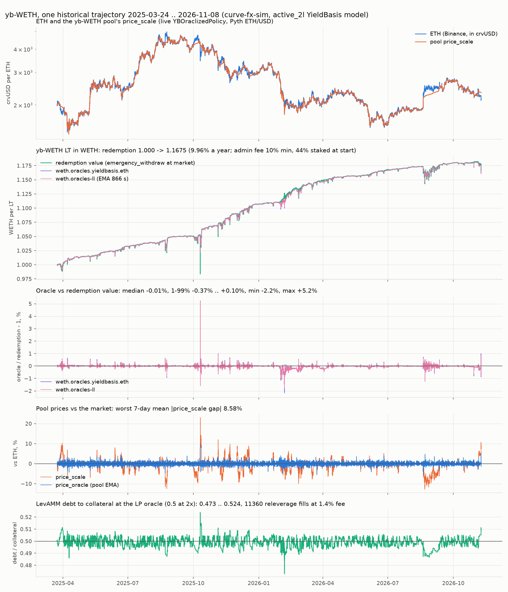
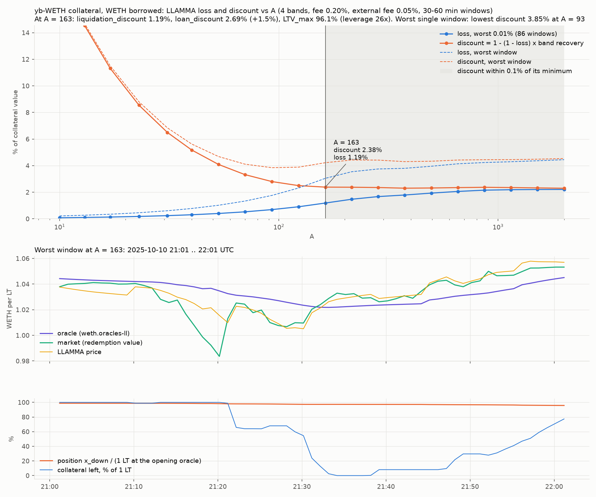
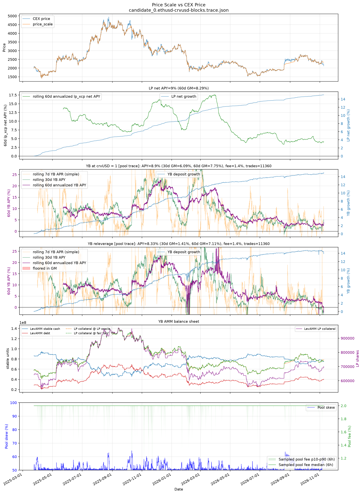

# yb-WETH as LlamaLend collateral for borrowing WETH

*2026-11-24. One historical simulation, 2025-03-24 .. 2026-11-09, of the yb-WETH pool under the policy live since
Curve ownership vote 1525, with the LT priced in WETH by the YieldBasis oracles and run through LlamaLend's LLAMMA.*

## Summary

| parameter | value |
| --- | --- |
| A | **163**: the low end of a plateau from A ≈ 160 to 2000 |
| liquidation_discount | **1.19%** |
| loan_discount | **2.69%** (liquidation discount + 1.5% margin) |
| max LTV | **96.1%**, about 26× leverage (94.6% with curvefi's 3% margin) |

- **The oracle tracks the LT's redemption value closely.** `weth.oracles-ll.yieldbasis.eth` (the LlamaLend variant)
  was within −0.38% .. +0.09% of the redemption value 98% of the time, with a median gap of −0.01%. It was more than 1%
  off 0.06% of the time. The extremes, +5.2% and −1.7%, came in the 2025-10-10 crash and the 2026-02-06 sell-off.
- **An unstaked LT grew from 1.000 to 1.1675 WETH**, 9.96% a year. That counts LT's live fee split: 10% minimum admin
  fee, with 44% of LT staked at the start.
- **One event sets the risk:** every one of the worst windows is the 2025-10-10 crash. In that hour the LT's
  redemption value dipped to 0.983 WETH and the oracle slid 2.1%.

## Setup

Live parameters, read on chain at block 26487413:

| | |
| --- | --- |
| pool | `0x656341Ef90b622c6634e0573772FfB7f3669b9f3`, A = 5, RPF 43%, `price_oracle` half-life 600 s |
| policy | `YBOraclizedPolicy` `0xC4561F25034Bc70CED5f034E863dD150f2bA763a`, Pyth Pro ETH/USD, fixed_rate@1000ms |
| fee | base 60 bp, capture 0.80, fallback 200 bp, relax 90 s |
| price_scale driver | EMA half-lives 90 / 180 min, trend gate 75 bp, step cap 50 bp, report lifetime 90 min |
| LevAMM | rate 1.80% on the debt (pool donation APY 0.90%), releverage fee 140 bp |
| LT | `min_admin_fee` 10%, 44.3% of LT staked |

The pipeline has three stages:

1. **Pool simulation.** curve-fx-sim (twocrypto-cpp + fx-arb-harness) is pinned at the commits of the 2026-11-13
   finalist runs this policy was tuned on, and uses their inputs, rebuilt and checked byte for byte. Those inputs are
   Binance ETH per 12 s slot, converted to crvUSD, and Pyth ETH/USD reports every second. The run starts from a fresh
   $57.5M pool and is traced every 60 s.
2. **LT prices** (`yb_prices.py`), all in WETH per LT:
   - both YieldBasis oracles: `weth.oracles.yieldbasis.eth` and its LlamaLend variant `weth.oracles-ll`;
   - the redemption value: what `LT.emergency_withdraw` pays out, valued at the market price;
   - LT's admin-fee and staker split, replayed along the trajectory.

   These are float ports of the yb-core contracts. They match the deployed contracts to within 1.2e-12 at six blocks.
3. **LlamaLend** (`llamma/`): phil-svg's byte-exact C++ LLAMMA v2, driven the way curvefi/llamma-simulator(_v2)
   prescribes:
   - the AMM reads `weth.oracles-ll`, checkpointed every minute (the keeper);
   - one arbitrageur per minute trades it at the redemption value, net of a 5 bp external cost;
   - 4 bands, fee 0.2%, windows of 30–60 minutes;
   - every minute of the history starts a window: 856,748 windows per A.

## 1. The LT in WETH: oracle and redemption value



*Panels from the top:*
1. *ETH and the pool's price_scale;*
2. *the LT in WETH: redemption value and both oracles;*
3. *oracle over redemption value, minus 1;*
4. *the pool's price_scale and price_oracle against the market;*
5. *the LevAMM's debt over its collateral.*

| | median | 1–99% | min | max | beyond ±1% |
| --- | --- | --- | --- | --- | --- |
| `weth.oracles.yieldbasis.eth` / redemption − 1 | −0.01% | −0.37% .. +0.10% | −2.2% | +5.2% | 0.06% of the time |
| `weth.oracles-ll` / redemption − 1 | −0.01% | −0.38% .. +0.09% | −1.7% | +5.2% | 0.06% of the time |

The oracles price the pool's LP at its `price_oracle`, a 10-minute EMA, not at `price_scale`. Panel 4 shows why that
matters: price_scale can stall for hours after a crash, while price_oracle follows the market. Two kinds of gap
remain:

- **A crash outruns the EMA.** At 2025-10-10 21:20 ETH was at 3458 crvUSD and price_oracle still at 3813. The oracle
  read 5.2% above the redemption value, which dipped to 0.983 WETH.
- **An under-levered LevAMM.** On 2026-02-06 its debt over collateral was 0.484. The oracle values the LevAMM after
  arbitrage back to 2× leverage, which costs LT holders; the redemption pays out its actual balances. The oracle read
  2.2% below.

The LlamaLend variant only adds an 866 s EMA on the slow part of the price (the LT's value at price_scale). With a
keeper refreshing it every minute it is practically the same price.

## 2. LlamaLend loss and discount vs A



*Top: loss (blue) and liquidation discount (orange) against A. Solid lines are the mean of the worst 0.01% of windows
(86 of 856,748); dashed lines are the single worst window. The shaded range is within 0.1% of the minimum discount.
Bottom: the worst window replayed at A = 163.*

| A | loss | discount | liquidation_discount | loan_discount (+1.5%) | max LTV (+1.5%) | max LTV (+3%) |
| --- | --- | --- | --- | --- | --- | --- |
| **163**, low end of the plateau | 1.19% | 2.38% | 1.19% | 2.69% | **96.1%** (25.7×) | 94.6% (18.6×) |
| 2000, the literal minimum | 2.21% | 2.30% | 2.21% | 3.71% | 96.2% (26.3×) | 94.7% |
| 93, minimum for the single worst window | 1.76% | 3.85% | 1.76% | 3.26% | 94.65% (18.7×) | 93.2% |

The discount falls from 18.5% at A = 10 to 2.38% at A = 163, then stays within 2.30–2.38% up to A = 2000. Above
A ≈ 160, four bands span less than the worst oracle dip, so in that event the position converts fully to WETH and the
loss is the dip's round trip, whatever A is.

Across the plateau the max LTV changes by 0.1% while the liquidation discount nearly doubles. A = 163 therefore keeps
the lowest liquidation discount and the widest bands for the same LTV. The worst single window on its own would
favour a lower A, about 93.

The worst window starts at 2025-10-10 21:01 UTC:

1. The redemption value falls 5.2%, from 1.038 to 0.984 WETH.
2. The oracle slides from 1.044 to 1.022.
3. By 21:34 the position has converted to WETH.
4. As the oracle recovers, arbitrageurs sell the LT back into it at 1.03–1.05.

That round trip is the loss.

## 3. The margin: 1.5% instead of 3%

curvefi's recipe adds 3% to the discount, for volatile collateral borrowed against USD. Here both the collateral and
the debt are in WETH, so only the LT/WETH ratio moves, and this report uses 1.5%.

The margin is how far the oracle can fall below where a max-LTV loan was opened before the loan becomes liquidatable.
How far the LlamaLend oracle fell below its previous high:

| fall below previous high | share of time | episodes |
| --- | --- | --- |
| more than 1% | 1.55% | 26 |
| more than 1.5% | 0.21% | 11 |
| more than 2% | 0.05% | 2 |
| more than 3% | 0 | 0 (deepest 2.96%, 2025-10-10) |

What that means:

- **The protocol stays covered.** Its protection against soft-liquidation losses is the liquidation discount, which
  the margin does not change.
- **The cost falls on max-leverage borrowers.** A loan opened at 96% LTV right at a high could have become
  liquidatable in about 11 episodes; with 3%, never in this history.
- **Rates also eat the margin.** WETH debt grows at the borrow rate while the LT grew about 10% a year in WETH. If
  borrowing costs 5% a year more than the LT earns, a 1.5% margin is gone in about 3½ months, a 3% margin in about 7.

## Validation

- **Oracles:** the ports of `weth.oracles.yieldbasis.eth`, `weth.oracles-ll`, `LT.pricePerShare` and
  `LT.preview_emergency_withdraw` match the deployed contracts to within 1.2e-12 at blocks 26337560 .. 26487560
  (`check_oracle_onchain.py`).
- **Trajectory:** the LT valuation rebuilt from the trace reproduces the harness's own LP oracle and LevAMM growth
  exactly.
- **LLAMMA position:** the engine's initial position value matches curvefi v2's `initial_recovery_coefficient` to
  3e-9.
- **LLAMMA losses:** across 16 window × A replays they agree with curvefi v2's Python `LendingAMM` to about 1e-7. The
  largest gap is 2.7e-4, in the crash window at A = 1000, between v2's float model and the uint256 engine
  (`llamma/check_vs_simulator_v2.py`).

## Caveats

- **History:** one trajectory of 1.63 years, and its tail is a single event. Windows are not time-reversed (the oracle
  would no longer be causal) and not volatility-rescaled (curvefi v2's stress option).
- **Arbitrage:** arbitrageurs act once a minute, because a per-block trace does not fit in memory. They exit at the
  redemption value for 5 bp. Under stress, `LT.withdraw` pays the pool fee on its imbalance, up to the 2% fallback.
- **Pool model:** the harness's YieldBasis model is not an on-chain parity claim. It has no deposits or withdrawals,
  and the LevAMM never touches the pool itself.
- **LT accounting:** the fee split assumes today's 44% staked at the start and no new staking; the staked share drifts
  to 40%. It barely matters within a 30–60 minute window.
- **Market parameters:** the LLAMMA fee is the A-scan default of 0.2%. A fee scan at A = 163 would be the next step.

## Reproduce

```sh
./setup.sh                                                             # pinned clones, builds, inputs
TRACE_INTERVAL=5 ./run.sh sim/weth-live-pyth.toml weth-live-pyth-60s   # pool simulation, 60 s trace, LT prices
llamma/run_scan.sh runs/weth-live-pyth-60s                             # loss vs A, ~12 min on 8 cores
```

See [README.md](README.md) for the method, file layout and options.

## Appendix: the pool replay



*fxopt's standard replay. Pool: LP APY 9.0%. YieldBasis: YB APY 8.9% at crvUSD par; the LevAMM's balance sheet;
pool fee and skew. Over the run: 11,360 releverage fills; the worst 7-day mean price_scale gap was 8.6%.*
